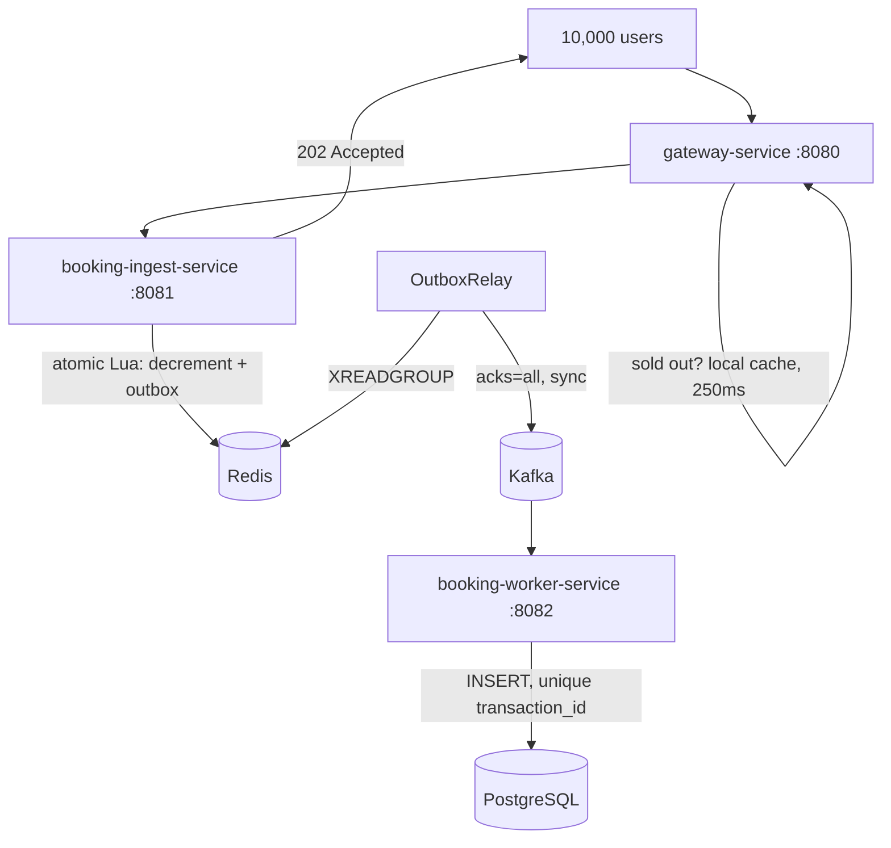

# High-Concurrency Flash Sale Booking Engine

A distributed booking system that sells a strictly limited inventory to a sudden burst of
concurrent buyers without overselling, double-booking, or losing inventory to a crash.

The hard part of a flash sale is not throughput — it is that **10,000 people try to buy 100
items in the same millisecond, and exactly 100 of them must win.** A relational database
asked to arbitrate that will serialise every request onto one contended row and collapse.
This system moves the contended decision into a single-threaded atomic Redis script and
persists durably afterwards, trading immediate consistency for throughput while keeping the
correctness guarantees that matter.

---

## Measured results

> Single instance of each service, all infrastructure in Docker on one developer machine:
> Intel Core i7-14700K (20 cores / 28 threads), 32 GB DDR5-5600, Ubuntu 24.04, OpenJDK 21.
> The load generator runs on the same host and competes with the services for CPU, so these
> figures understate what the architecture achieves with the client on separate hardware.

### 10,000 concurrent users → 100 items

Every request is issued from its own virtual thread; all 10,000 block on a single starting
gate so the traffic arrives as a genuine thundering herd rather than a ramp.

**Correctness — identical in every run:**

```
  HTTP 202      100    slot secured
  HTTP 410    9,900    sold out
  errors          0

  Redis stock          0
  distinct holders   100
  orders persisted   100   (100 distinct users, 100 distinct transaction ids)
  oversold             0
```

**Throughput — five consecutive runs, warm JVM:**

```
  13,550   11,561   12,019   13,021   13,831   req/s
  median 13,021 · range 11,561–13,831 · spread ~17% of median
  full burst drains in 723–865 ms
```

A single throughput number from a developer workstation is noise. Five runs with the spread
stated is the minimum that means anything, and the variance here is larger than most of the
differences one would want to claim between configurations.

**The first run after restarting a service yields ~4,500 req/s** — about a third of warm
throughput — while the JVM loads classes and the JIT compiles the hot path. Reported
separately as the cold-start figure rather than averaged in.

Latency is **queue depth, not service time**: 10,000 requests arrive in the same instant and
drain at ~13,000/s, so the median request waits behind roughly 5,000 others. Per-request
service time stays flat.

### On the architectural progression

Earlier revisions — inline Kafka publish on the request path, then the outbox without edge
admission control — measured lower. Each was a single run, and single runs vary by more than
the differences being claimed, so **those comparisons are not reported here as measurements.**

The reasoning behind each change stands on its own: moving the Kafka publish off the request
path and rejecting sold-out traffic at the edge both remove network round trips from the hot
path, and removing work cannot make it slower. Quantifying the gain would require five warm
runs per configuration. That work has not been done, so no figure is quoted.

### What admission control actually buys

During one instrumented run the ingest service counted 9,181 sold-out responses while clients
received 9,900 — the missing **719 were rejected at the gateway** and never reached the
service.

7.3%, not the near-total shedding one might expect, and the reason is worth understanding:
the edge check happens when a request *enters* the gateway, and in a thundering herd nearly
all 10,000 arrive before stock runs out. The sold-out flag helps traffic arriving *after* the
sellout — retries, stragglers, a sale that stays open for minutes — not a single instantaneous
spike.

### Crash resilience: `SIGKILL` mid-sale

The ingest service is killed with `SIGKILL` one second into a 20,000-user burst against
5,000 items — no graceful shutdown, no buffer flush, the way a pod dies when a node fails.

| | dual write | transactional outbox |
|---|---|---|
| slots granted in Redis | 3,414 | 2,941 |
| orders persisted | 3,401 | 2,941 |
| **items permanently lost** | **13** (0.38%) | **0** |
| duplicate order rows | — | 0 |

In the dual-write version, Redis decremented inventory and the JVM then published to Kafka
as a separate step. Processes killed in that window consumed a slot with no order behind it:
inventory that can never be sold and never be recovered, because PostgreSQL is a *floor*,
not a count of what was granted.

With the outbox, the decrement and the event record commit in the same atomic Lua execution.
After the crash, every event was still in Redis and the restarted relay delivered all of it.
`orders` equal to `distinct transaction_id` confirms that recovery re-published records that
had already reached Kafka and the unique constraint absorbed every one: **at-least-once
delivery, exactly-once persistence.**

---

### Graceful degradation: Redis stopped mid-operation

Resilience4j circuit breaker on the inventory call, with a 1-second Lettuce command timeout.

| | before | after |
|---|---|---|
| Degraded response, ingest service | 1,010 ms | **5 ms** once the breaker opens |
| Degraded response, through the gateway | **121 s** | **2–3 s** |
| Recovery to `CLOSED` after Redis returns | 30 s+ | **under 11 s** |

Three details behind those numbers, each of which cost more to find than to fix:

**Lettuce's default command timeout is 60 seconds.** The gateway makes two Redis calls per
request — the sold-out check and the rate limiter — so an unreachable Redis stalled every
request for 121 seconds. A circuit breaker cannot help here: an unbounded call never fails,
so there is nothing to trip on. **Timeouts are the foundation every other resilience pattern
is built on.**

**Lettuce's default reconnect backoff caps at 30 seconds.** After a multi-minute outage the
client sits in a 30-second sleep, so the service stays degraded long after Redis is healthy
no matter how often the breaker probes. Capping the backoff at 2 seconds makes recovery
bounded by the breaker's wait duration, which is the knob actually intended to control it.

**The breaker records only connection failures and timeouts**, not every exception. Counting
application errors would mean a bug in the Lua script trips the breaker and gets reported to
users as a calm "system busy" — turning a loud, fixable error into a silent one. A circuit
breaker protects a healthy system from a sick dependency; it is not an error handler.

### Reconciliation and convergence

A scheduled job compares the users holding a slot in Redis against the orders durably written
to PostgreSQL. It is a **set difference**, not a subtraction of totals — the orders table
accumulates across sales while `booked_users` is cleared at each warm-up, so comparing counts
hides real divergence behind a negative number.

```
unexplainedGap = |slotHolders \ usersWithOrders| − outboxPending
```

Sampled once per second during a 5,000-slot sale:

```
granted=5000  without_order=4425  outbox_pending=500  gap=3925
granted=5000  without_order=4060  outbox_pending=500  gap=3560
granted=5000  without_order=3574  outbox_pending=  0  gap=3574
granted=5000  without_order=3100  outbox_pending=  0  gap=3100
granted=5000  without_order=2654  outbox_pending=  0  gap=2654
granted=5000  without_order=2169  outbox_pending=  0  gap=2169
granted=5000  without_order=1684  outbox_pending=  0  gap=1684
granted=5000  without_order=1182  outbox_pending=  0  gap=1182
granted=5000  without_order= 736  outbox_pending=  0  gap= 736
granted=5000  without_order= 127  outbox_pending=  0  gap= 127
```

That is eventual consistency made visible: ~450 orders/second draining to zero, with
`outbox_pending` capped at the relay's 500-entry batch size and `without_order` showing work
already in Kafka awaiting the worker. For a 100-slot sale the whole pipeline converges in
under half a second — faster than a shell command can observe it.

**The gap is expected to be positive during and just after a sale.** At any single instant you
cannot distinguish "late" from "lost" — only elapsed time distinguishes them. So the service
publishes the number and nothing else; the judgement belongs in an alert rule that fires when
`booking_reconciliation_unexplained_gap` stays non-zero across consecutive scrapes.

**What this catches that nothing else does:** a Lua script that failed partway through, after
consuming a slot but before writing its outbox entry. Redis does not roll back, so the slot is
gone and no event exists anywhere in the system. Verified by injecting exactly that state
(`SADD booked_users ghost_user`) and confirming the gauge reports it — a check for failure
that has only ever been tested against healthy data is not a check.

### Observability

`/actuator/prometheus` exposes the invariants as metrics:

```
booking_attempts_total{result="acquired"}        100.0
booking_attempts_total{result="sold_out"}       9181.0
booking_attempts_total{result="already_booked"}    0.0
booking_attempts_total{result="not_available"}     0.0
booking_attempts_total{result="unknown"}           0.0
booking_outbox_published_total                   100.0
booking_outbox_relay_errors_total                  0.0
resilience4j_circuitbreaker_state{state="closed"}  1.0
```

`booking_attempts_total{result="acquired"}` is invariant 1 as a number a monitoring system can
alert on: if it ever exceeds the stock that was warmed up, the system oversold. Every outcome
is registered at startup rather than on first occurrence, so each series exists at zero from
the beginning — a counter that springs into existence on its first increment can never trigger
an alert that watches for it.

`booking_outbox_relay_errors_total` is the one that matters operationally. During development
the relay failed ten times a second for several minutes while the request path looked perfectly
healthy. A counter climbing on a graph is how that gets noticed in seconds rather than from a
reconciliation query days later.

## Invariants

The system is designed around three properties, in priority order:

1. **Never oversell.** 100 items means at most 100 confirmed orders under any concurrency.
2. **One slot per user.** The same person clicking twenty times gets one.
3. **Stay responsive.** Answer in milliseconds; shed load rather than collapse.

Every design decision below serves one of these, and the load test verifies all three.

---

## Architecture



**gateway-service** — Spring Cloud Gateway. A Redis-backed token bucket rate-limits per user,
and a global filter rejects sold-out items at the edge using a 250 ms local Caffeine cache.

**booking-ingest-service** — The hot path. One Lua script decides everything; the HTTP
response returns immediately after it. A scheduled relay drains the Redis Stream outbox into
Kafka on a dedicated platform thread.

**booking-worker-service** — Consumes `booking-confirmed-topic` and writes orders. Owns the
Flyway migrations.

### The atomic decision

```lua
if redis.call('EXISTS', KEYS[1]) == 0 then return -2 end          -- sale not open
if redis.call('SISMEMBER', KEYS[2], ARGV[1]) == 1 then return -1 end  -- already booked
local stock = tonumber(redis.call('GET', KEYS[1]))
if stock == nil or stock <= 0 then return 0 end                   -- sold out

local remaining = redis.call('DECR', KEYS[1])
redis.call('SADD', KEYS[2], ARGV[1])
redis.call('XADD', KEYS[3], '*', ...)                             -- the outbox
if remaining <= 0 then redis.call('SET', KEYS[4], '1', 'EX', ttl) end  -- edge flag
return 1
```

Redis executes this on a single thread with no interleaving, so the check and the decrement
cannot race, and the slot and its event cannot disagree.

---

## Design decisions

**Redis holds the counter, PostgreSQL holds the truth.** During the sale, PostgreSQL is never
read or written on the request path. A warm-up endpoint copies `total_stock` into Redis before
the sale opens; `total_stock` itself never decreases.

**Transactional outbox over dual write.** The measured cost of getting this wrong is in the
crash table above.

**Deterministic transaction ids.** `UUID.nameUUIDFromBytes(itemId + "#" + userId)`. A user can
hold at most one slot per item, so that pair uniquely identifies the booking — which means a
client retry after a timeout produces the *same* id and the unique constraint recognises it.
A random UUID would have produced a second order.

**The database arbitrates duplicates.** The worker inserts and catches
`DataIntegrityViolationException` rather than checking `existsByTransactionId` first.
Check-then-act races between worker instances; the constraint does not, and it costs one
round trip instead of two.

**Admission control caches locally, and fails open.** Checking the sold-out flag in Redis per
request would merely relocate the load. A 250 ms Caffeine window bounds it to four Redis calls
per second per item regardless of traffic. If Redis is unreachable the filter assumes *not*
sold out and lets traffic through — a performance optimisation must never be able to stop the
system selling.

**Staleness is asymmetric.** A cache that says "available" when the item is gone costs one
wasted round trip and the Lua script answers correctly. A cache that says "sold out" when
stock exists rejects a real buyer, and can only occur in the 250 ms after a warm-up re-opens
an item. Warm-up happens before a sale opens, so that window sees no traffic.

**Virtual threads on blocking I/O.** Java 21 virtual threads throughout the ingest service and
the load generator. 10,000 platform threads would cost gigabytes of stack; virtual threads
cost a few hundred bytes each.

**Kafka in KRaft mode.** No ZooKeeper — it was removed in Kafka 4.0.

---

## Known limitations

Deliberately listed, not hidden.

**Lua scripts are atomic but not transactional.** A script that errors midway leaves its
earlier commands applied — Redis has no rollback. This was not theoretical: a missing `local`
declaration caused the script to fail *after* decrementing inventory, writing the user to the
booked set and appending to the outbox. Every one of those requests returned an error to the
caller while creating a real, paid-for order. The system needs a reconciliation job comparing
`booked_users` against persisted orders and flagging divergence. It does not have one yet.

**The relay shares a JVM with request handling.** With `spring.threads.virtual.enabled=true`,
Spring schedules `@Scheduled` tasks on virtual threads — and under load the relay lost its
carrier thread to request handling and stopped running entirely. Mitigated by giving it a
dedicated platform-thread scheduler. The structural fix is extracting it into its own
deployable that scales independently.

**The Redis key format is duplicated** between the ingest service and the gateway, because the
services share no common module. A shared contracts artifact is the proper fix.

**Authentication is out of scope.** The gateway is `permitAll()` and an `X-User-Id` header
stands in for a verified JWT claim. Swapping in a real resource server is contained: add
`spring-boot-starter-oauth2-resource-server`, set `issuer-uri`, and replace `permitAll()` with
`authenticated()` plus `.oauth2ResourceServer(...)`.

**One database for two services.** Real microservices would have a database each; the worker
service owns all migrations here as a deliberate simplification.

**No compensation path.** If a message is permanently dead-lettered, the Redis slot stays
consumed. A reverse flow should re-increment inventory and remove the user from the set.
Reconciliation detects this state but does not repair it.

**The gateway has timeouts but no circuit breaker.** Its two Redis calls per request are
unprotected, so during a Redis outage every request pays the full timeout on both — about
2 seconds — for as long as the outage lasts, even though the ingest service behind it is
already failing fast. The rate limiter also has no local cache, unlike the sold-out filter.

**The load test is a script, not a test suite.** It should be promoted to JUnit with
Testcontainers so it runs in CI.

**Single-node benchmark, client on the same host.** All numbers come from one machine with
one instance of each service, and the load generator competes with them for CPU. They
demonstrate correctness under concurrency; they are not capacity planning figures.

---

## Running it

Requires Java 21+, Docker, and Docker Compose.

```bash
docker compose up -d
docker compose ps        # wait for all three to report healthy
```

Infrastructure is published on **Redis 6380** and **PostgreSQL 5433** to avoid colliding with
local installs; Kafka is on 9092. Change the port mappings in `docker-compose.yml` and the
matching `application.yaml` entries if that doesn't suit you.

Each service is a standalone Maven project. In three terminals:

```bash
cd booking-ingest-service && ./mvnw spring-boot:run
cd booking-worker-service && ./mvnw spring-boot:run
cd gateway-service        && ./mvnw spring-boot:run
```

Open a sale and buy something:

```bash
curl -X POST http://localhost:8081/api/v1/admin/sales/limited-item-01/warmup

curl -i -X POST http://localhost:8080/api/v1/bookings/items/limited-item-01 \
  -H "X-User-Id: user_001"
```

### Running the load test

```bash
ulimit -n 65535          # 10,000 concurrent sockets
cd load-test
java FlashSaleLoadTest.java
java -Dusers=20000 -Dtarget=http://localhost:8080 FlashSaleLoadTest.java
```

No dependencies — Java 21's single-file source launcher runs it directly. It warms the sale
itself, so the only manual prep is truncating `orders` between runs.

Then verify the invariants:

```bash
docker exec booking-redis redis-cli GET   "item:{limited-item-01}:inventory"   # 0
docker exec booking-redis redis-cli SCARD "item:{limited-item-01}:booked_users" # 100
docker exec booking-redis redis-cli XPENDING "item:{limited-item-01}:outbox" outbox-relay  # 0
docker exec booking-postgres psql -U postgres -d booking_db -c \
  "SELECT count(*) AS orders, count(DISTINCT user_id) AS users, \
          count(DISTINCT transaction_id) AS txids FROM orders;"                 # 100 100 100
```

### Reproducing the crash test

```bash
docker exec booking-postgres psql -U postgres -d booking_db -c \
  "UPDATE products SET total_stock = 5000 WHERE id = 'limited-item-01';"
docker exec booking-postgres psql -U postgres -d booking_db -c "TRUNCATE orders RESTART IDENTITY;"

cd load-test
( sleep 1.0; pkill -9 -f BookingIngestServiceApplication ) &
java -Dusers=20000 FlashSaleLoadTest.java
```

Restart the ingest service so the relay can drain what the dead process left behind, wait
~30 seconds, then compare `SCARD` against the order count. They should be equal.

---

## API

| Method | Path | Port | Description |
|---|---|---|---|
| `POST` | `/api/v1/bookings/items/{itemId}` | 8080 | Attempt a booking. Requires `X-User-Id`. |
| `POST` | `/api/v1/admin/sales/{itemId}/warmup` | 8081 | Open or reset a sale. Not routed through the gateway. |

Booking responses: `202` slot secured · `409` already booked · `410` sold out ·
`404` sale not open · `429` rate limited · `503` degraded.

---

## Stack

Java 21 (virtual threads) · Spring Boot 3.5 · Spring Cloud Gateway · Spring Cloud Stream ·
Redis 7.4 (Lua, Streams, AOF) · Apache Kafka (KRaft) · PostgreSQL 16 · Flyway · Caffeine ·
Resilience4j · Micrometer / Prometheus · Docker Compose
