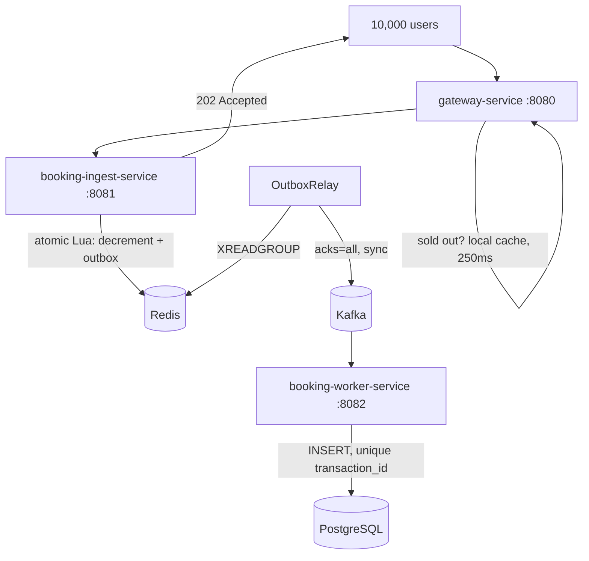

# High-Concurrency Flash Sale Booking Engine

A distributed booking system that sells a strictly limited inventory to a sudden burst of
concurrent buyers without overselling, double-booking, or losing inventory to a crash.

The hard part of a flash sale is not throughput — it is that **10,000 people try to buy 100
items in the same millisecond, and exactly 100 of them must win.** A relational database
asked to arbitrate that will serialise every request onto one contended row and collapse.
This system moves the contended decision into a single-threaded atomic Redis script and
persists durably afterwards, trading immediate consistency for throughput while keeping the
correctness guarantees that matter.

---

## Measured results

> Single instance of each service, all infrastructure in Docker on one developer machine:
> Intel Core i7-14700K (20 cores / 28 threads), 32 GB DDR5-5600, Ubuntu 24.04, OpenJDK 21.
> The load generator runs on the same host and competes with the services for CPU, so these
> figures understate what the architecture achieves with the client on separate hardware.

### 10,000 concurrent users → 100 items

Every request is issued from its own virtual thread; all 10,000 block on a single starting
gate so the traffic arrives as a genuine thundering herd rather than a ramp.

```
  HTTP 202      100    slot secured
  HTTP 410    9,900    sold out
  errors          0

  latency       p50 316 ms   p95 574 ms   p99 649 ms   max 676 ms
  throughput    10,799 req/s  (926 ms to drain the full burst)

  Redis stock          0
  distinct holders   100
  orders persisted   100   (100 distinct users, 100 distinct transaction ids)
  oversold             0
```

Latency here is **queue depth, not service time**. Ten thousand requests arrive at the same
instant and drain at ~10,800/s, so the median request waits behind roughly 5,000 others.
Per-request service time stays flat.

### Throughput across three architectural revisions

Each row is the same test against the same invariants — only the architecture changed.

| | throughput | p50 | p95 | p99 | wall |
|---|---|---|---|---|---|
| Inline Kafka publish on the request path | 6,798 req/s | 787 ms | ~1,208 ms | 1,242 ms | 1,471 ms |
| Transactional outbox + background relay | 8,446 req/s | 318 ms | 717 ms | 748 ms | 1,184 ms |
| \+ edge admission control | **10,799 req/s** | **316 ms** | **574 ms** | **649 ms** | **926 ms** |

Two results worth calling out:

**Moving the Kafka publish off the request path made the system both safer and faster**
(+24% throughput, p50 787 → 318 ms) *while* upgrading from fire-and-forget publishing to
synchronous `acks=all`. Durability and latency usually trade against each other; decoupling
bought both.

**Admission control delivered +28% by eliminating network round trips, not computation.**
Each of the 9,900 losing requests had been paying for a Redis call at the gateway for rate
limiting, a TCP hop to the ingest service, and a second Redis call for the inventory script.
Three round trips, all avoidable once the item is gone.

### Crash resilience: `SIGKILL` mid-sale

The ingest service is killed with `SIGKILL` one second into a 20,000-user burst against
5,000 items — no graceful shutdown, no buffer flush, the way a pod dies when a node fails.

| | dual write | transactional outbox |
|---|---|---|
| slots granted in Redis | 3,414 | 2,941 |
| orders persisted | 3,401 | 2,941 |
| **items permanently lost** | **13** (0.38%) | **0** |
| duplicate order rows | — | 0 |

In the dual-write version, Redis decremented inventory and the JVM then published to Kafka
as a separate step. Processes killed in that window consumed a slot with no order behind it:
inventory that can never be sold and never be recovered, because PostgreSQL is a *floor*,
not a count of what was granted.

With the outbox, the decrement and the event record commit in the same atomic Lua execution.
After the crash, every event was still in Redis and the restarted relay delivered all of it.
`orders` equal to `distinct transaction_id` confirms that recovery re-published records that
had already reached Kafka and the unique constraint absorbed every one: **at-least-once
delivery, exactly-once persistence.**

---

## Invariants

The system is designed around three properties, in priority order:

1. **Never oversell.** 100 items means at most 100 confirmed orders under any concurrency.
2. **One slot per user.** The same person clicking twenty times gets one.
3. **Stay responsive.** Answer in milliseconds; shed load rather than collapse.

Every design decision below serves one of these, and the load test verifies all three.

---

## Architecture



**gateway-service** — Spring Cloud Gateway. A Redis-backed token bucket rate-limits per user,
and a global filter rejects sold-out items at the edge using a 250 ms local Caffeine cache.

**booking-ingest-service** — The hot path. One Lua script decides everything; the HTTP
response returns immediately after it. A scheduled relay drains the Redis Stream outbox into
Kafka on a dedicated platform thread.

**booking-worker-service** — Consumes `booking-confirmed-topic` and writes orders. Owns the
Flyway migrations.

### The atomic decision

```lua
if redis.call('EXISTS', KEYS[1]) == 0 then return -2 end          -- sale not open
if redis.call('SISMEMBER', KEYS[2], ARGV[1]) == 1 then return -1 end  -- already booked
local stock = tonumber(redis.call('GET', KEYS[1]))
if stock == nil or stock <= 0 then return 0 end                   -- sold out

local remaining = redis.call('DECR', KEYS[1])
redis.call('SADD', KEYS[2], ARGV[1])
redis.call('XADD', KEYS[3], '*', ...)                             -- the outbox
if remaining <= 0 then redis.call('SET', KEYS[4], '1', 'EX', ttl) end  -- edge flag
return 1
```

Redis executes this on a single thread with no interleaving, so the check and the decrement
cannot race, and the slot and its event cannot disagree.

---

## Design decisions

**Redis holds the counter, PostgreSQL holds the truth.** During the sale, PostgreSQL is never
read or written on the request path. A warm-up endpoint copies `total_stock` into Redis before
the sale opens; `total_stock` itself never decreases.

**Transactional outbox over dual write.** The measured cost of getting this wrong is in the
crash table above.

**Deterministic transaction ids.** `UUID.nameUUIDFromBytes(itemId + "#" + userId)`. A user can
hold at most one slot per item, so that pair uniquely identifies the booking — which means a
client retry after a timeout produces the *same* id and the unique constraint recognises it.
A random UUID would have produced a second order.

**The database arbitrates duplicates.** The worker inserts and catches
`DataIntegrityViolationException` rather than checking `existsByTransactionId` first.
Check-then-act races between worker instances; the constraint does not, and it costs one
round trip instead of two.

**Admission control caches locally, and fails open.** Checking the sold-out flag in Redis per
request would merely relocate the load. A 250 ms Caffeine window bounds it to four Redis calls
per second per item regardless of traffic. If Redis is unreachable the filter assumes *not*
sold out and lets traffic through — a performance optimisation must never be able to stop the
system selling.

**Staleness is asymmetric.** A cache that says "available" when the item is gone costs one
wasted round trip and the Lua script answers correctly. A cache that says "sold out" when
stock exists rejects a real buyer, and can only occur in the 250 ms after a warm-up re-opens
an item. Warm-up happens before a sale opens, so that window sees no traffic.

**Virtual threads on blocking I/O.** Java 21 virtual threads throughout the ingest service and
the load generator. 10,000 platform threads would cost gigabytes of stack; virtual threads
cost a few hundred bytes each.

**Kafka in KRaft mode.** No ZooKeeper — it was removed in Kafka 4.0.

---

## Known limitations

Deliberately listed, not hidden.

**Lua scripts are atomic but not transactional.** A script that errors midway leaves its
earlier commands applied — Redis has no rollback. This was not theoretical: a missing `local`
declaration caused the script to fail *after* decrementing inventory, writing the user to the
booked set and appending to the outbox. Every one of those requests returned an error to the
caller while creating a real, paid-for order. The system needs a reconciliation job comparing
`booked_users` against persisted orders and flagging divergence. It does not have one yet.

**The relay shares a JVM with request handling.** With `spring.threads.virtual.enabled=true`,
Spring schedules `@Scheduled` tasks on virtual threads — and under load the relay lost its
carrier thread to request handling and stopped running entirely. Mitigated by giving it a
dedicated platform-thread scheduler. The structural fix is extracting it into its own
deployable that scales independently.

**The Redis key format is duplicated** between the ingest service and the gateway, because the
services share no common module. A shared contracts artifact is the proper fix.

**Authentication is out of scope.** The gateway is `permitAll()` and an `X-User-Id` header
stands in for a verified JWT claim. Swapping in a real resource server is contained: add
`spring-boot-starter-oauth2-resource-server`, set `issuer-uri`, and replace `permitAll()` with
`authenticated()` plus `.oauth2ResourceServer(...)`.

**One database for two services.** Real microservices would have a database each; the worker
service owns all migrations here as a deliberate simplification.

**No compensation path.** If a message is permanently dead-lettered, the Redis slot stays
consumed. A reverse flow should re-increment inventory and remove the user from the set.

**No circuit breaker.** Redis failures surface as 503 through the `UNKNOWN` branch, but
nothing trips or recovers deliberately.

**The load test is a script, not a test suite.** It should be promoted to JUnit with
Testcontainers so it runs in CI.

**Single-node benchmark.** All numbers come from one machine with one instance of each
service. They demonstrate correctness under concurrency and relative improvement between
revisions; they are not capacity planning figures.

---

## Running it

Requires Java 21+, Docker, and Docker Compose.

```bash
docker compose up -d
docker compose ps        # wait for all three to report healthy
```

Infrastructure is published on **Redis 6380** and **PostgreSQL 5433** to avoid colliding with
local installs; Kafka is on 9092. Change the port mappings in `docker-compose.yml` and the
matching `application.yaml` entries if that doesn't suit you.

Each service is a standalone Maven project. In three terminals:

```bash
cd booking-ingest-service && ./mvnw spring-boot:run
cd booking-worker-service && ./mvnw spring-boot:run
cd gateway-service        && ./mvnw spring-boot:run
```

Open a sale and buy something:

```bash
curl -X POST http://localhost:8081/api/v1/admin/sales/limited-item-01/warmup

curl -i -X POST http://localhost:8080/api/v1/bookings/items/limited-item-01 \
  -H "X-User-Id: user_001"
```

### Running the load test

```bash
ulimit -n 65535          # 10,000 concurrent sockets
cd load-test
java FlashSaleLoadTest.java
java -Dusers=20000 -Dtarget=http://localhost:8080 FlashSaleLoadTest.java
```

No dependencies — Java 21's single-file source launcher runs it directly. It warms the sale
itself, so the only manual prep is truncating `orders` between runs.

Then verify the invariants:

```bash
docker exec booking-redis redis-cli GET   "item:{limited-item-01}:inventory"   # 0
docker exec booking-redis redis-cli SCARD "item:{limited-item-01}:booked_users" # 100
docker exec booking-redis redis-cli XPENDING "item:{limited-item-01}:outbox" outbox-relay  # 0
docker exec booking-postgres psql -U postgres -d booking_db -c \
  "SELECT count(*) AS orders, count(DISTINCT user_id) AS users, \
          count(DISTINCT transaction_id) AS txids FROM orders;"                 # 100 100 100
```

### Reproducing the crash test

```bash
docker exec booking-postgres psql -U postgres -d booking_db -c \
  "UPDATE products SET total_stock = 5000 WHERE id = 'limited-item-01';"
docker exec booking-postgres psql -U postgres -d booking_db -c "TRUNCATE orders RESTART IDENTITY;"

cd load-test
( sleep 1.0; pkill -9 -f BookingIngestServiceApplication ) &
java -Dusers=20000 FlashSaleLoadTest.java
```

Restart the ingest service so the relay can drain what the dead process left behind, wait
~30 seconds, then compare `SCARD` against the order count. They should be equal.

---

## API

| Method | Path | Port | Description |
|---|---|---|---|
| `POST` | `/api/v1/bookings/items/{itemId}` | 8080 | Attempt a booking. Requires `X-User-Id`. |
| `POST` | `/api/v1/admin/sales/{itemId}/warmup` | 8081 | Open or reset a sale. Not routed through the gateway. |

Booking responses: `202` slot secured · `409` already booked · `410` sold out ·
`404` sale not open · `429` rate limited · `503` degraded.

---

## Stack

Java 21 (virtual threads) · Spring Boot 3.5 · Spring Cloud Gateway · Spring Cloud Stream ·
Redis 7.4 (Lua, Streams, AOF) · Apache Kafka (KRaft) · PostgreSQL 16 · Flyway · Caffeine ·
Docker Compose